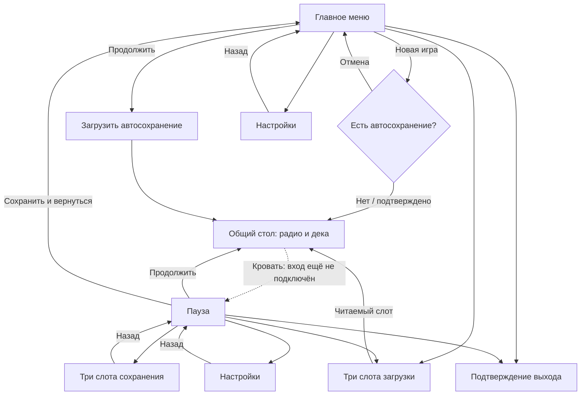

# Главное меню и путь игрока

Образец реализован 19.11.2026 в UE **5.0.3** по `UI_DESIGN.zip`, переданному Doki. Макеты Прохора и видеоподложка сохранены в `Tools/MenuBuilder/Art`, шрифт — **IBM Plex Mono Medium / SemiBold** с кириллицей. Графы, виджет и SaveGame находятся в `Content/UI`; игрового C++ модуля нет.

Doki разрешил продолжение реализации и push изменений. Последний проход убирает синюю боковую ленту, верхние игровые переходы и утечку субтитров; актуальные проверки — раздел 14 UE-плана. Результаты предыдущих версий ниже не подменяют проверку последней.

## Запуск и экраны

Открыть `nto_dead_air.uproject`, нажать Play на стартовой `MainMenuMap`. «Новая игра», «Продолжить» и загрузка из главного меню открывают общий стол `StationIntegrationMap` с радио и декой. Верхняя игровая кнопка **МЕНЮ** удалена по запросу Doki, как и быстрые переходы между приборами. Вход в паузу через кровать запланирован; пока нового игрового входа нет. Сами страницы паузы и сохранений сохранены и проверяются через менеджер.

Утверждено Doki: курсор виден в главном меню, паузе, слотах, настройках и подтверждениях; после входа/продолжения в обзор стола скрыт, у прибора снова виден. ПКМ выходит от прибора к обзору. Курсор центрируется при появлении. Над верхним краем сцены он остаётся скрытым, движение камеры там не блокируется интерфейсом. При закрытии меню восстанавливать видимость по режиму камеры; курсор меню не должен уводить взгляд при возврате. Приёмочный путь — MECHANICS, «Уточнения управления и план кассет».

| Экран | Действия |
|---|---|
| Главное меню | Продолжить, новая игра, загрузить, настройки, выход |
| Пауза | Продолжить, сохранить, загрузить, настройки, главное меню, выход |
| Сохранить / загрузить | Три ручных слота с датой и временем, назад. Пустые и нечитаемые слоты недоступны для загрузки |
| Настройки | Общая громкость 0–100%, субтитры, назад. Применяются сразу, записываются отдельно от смены |
| Подтверждение | Новая смена при существующем автосохранении, перезапись слота, возврат в меню с сохранением и выход. Отмена не меняет сохранения; подложка не получает клики |

Меню использует 1920×1080 внутри ScaleBox с сохранением пропорций. Боковая подложка нейтрально-чёрная с непрозрачностью от 99% слева до 64% справа; заголовок DEAD AIR — отдельный TextBlock. Затемнение/виньетка не перекрывают читаемость кнопок. Кнопки — UMG, тексты не запечены в картинки. Наведение золотое, недоступные действия приглушены. Фон — предоставленное видео в `Content/Movies`; для DirectX 12 включён штатный **ElectraPlayer** из UE 5.0.3. Стороннего видеоплагина нет.

## Что сохраняется сейчас

Учебный сеанс: дробная частота, фильтр, громкость радио, питание и позиция эфира; наличие кассеты и её позиция. Последнее требование — дополнительно сохранять режим STOP/PLAY/FF/REW и зафиксированную клавишу; PAUSE заменена FF ×3. Локальный прогон подтвердил восстановление FF через главное меню, но общий транспорт ещё не принят. Ручное сохранение также обновляет автосохранение для «Продолжить»; при начале новой игры ручные слоты остаются. При выходе в главное меню создаётся автосохранение, при ошибке записи переход отменяется. Простое закрытие приложения через «Выход» использует уже записанные слоты.

Файлы находятся в `Saved/SaveGames`: `DA_UI_Auto`, `DA_UI_Manual_1..3`, `DA_UI_Prefs`. В упакованной игре — каталог Saved приложения. Версия структуры и диапазоны параметров проверяются перед загрузкой. Повреждённый файл оставляет рабочее меню и сообщение об ошибке. Во время перехода повторная загрузка блокируется.

**Граница образца:** это сохранение радио и учебной кассеты, не готовое сохранение всей истории. Старые файлы Version=1 без HasWorkstation читаются с пустой декой; новые используют дополнительный флаг HasWorkstation и проверяют диапазон TapePosition/согласованность паузы. Камера после входа из меню начинает с обзора стола. Загрузка намеренно восстанавливает момент записи; обычная перенастройка радио по-прежнему продолжает эфир без перезапуска. Сюжетные этапы, часы, архив, кассеты, журнал, исход 50/50 и флаг финала нужно добавить Славе по разделу сохранений UE-плана. До этого «Продолжить» означает текущий учебный сеанс; завершённая сюжетная смена пока отсутствует.

## Как продолжать Славе

1. Прочитать `BP_MenuManager`: `InitializeUI`, `ShowMain/OpenPause`, `OpenSave/OpenLoad`, `RequestLoad`, `ApplyCheckpoint`, `CaptureAndSave`. `WBP_StationMenu` отображает данные менеджера и передаёт действия; файлы не читаются из биндингов каждый кадр.
2. Сохранить имена и связи экранов. Подключить основной игровой маршрут через `StartNewGame` и `RequestLoad`; актор менеджера разместить на основной карте, GameInstance оставить `BP_MenuGameInstance`.
3. Расширить `SG_StationCheckpoint` полями принятого сценария и миграцией Version. Сначала восстановить все системы, затем снять паузу. Добавить завершённость смены и закрытие «Продолжить» после финала. Не хранить выбранный исход делегирования в UI.
4. Радио и дека должны звучать независимо. ReadSubtitle показывает слышимые источники с метками РАДИО / ДЕКА; при одновременном звуке нужны обе строки. DT_ReceiverCaptions содержит интервалы постепенного появления слов временной записи, привязанные к фактической позиции аудио. При замене VO переуточнить таймкоды и соответствие кассете. Галочка SG_UserPreferences скрывает оба источника.
5. Перед правками бинарных ассетов согласовать владельца. Редакторский генератор не запускать поверх ручных изменений: он пересоздаёт меню. Его исходник нужен как воспроизводимый пример, а не как runtime-зависимость.

## Приёмка

Проверить мышью: запуск без сохранений → настройки → назад → новая игра → проявление общего стола → приближения и ПКМ. Проверку паузы/трёх слотов/отмен/возврата пока запускать через менеджер; после подключения кровати повторить весь путь физической мышью. Отдельно — настройки после перезапуска приложения, нечитаемый слот и повторная загрузка. Проверка полной смены и финалов остаётся за основной интеграцией.

19.11: 35 автоматических PIE-проверок прошли; Windows Development-пакет собран. Подробности проверки и ограничение физического ввода — раздел 12 [UE-плана](UE5_ARCHITECTURE.md#12-меню-по-макетам-прохора). [Вид главного меню](../artifacts/menu-main.png), [слотов](../artifacts/menu-save.png), [настроек](../artifacts/menu-settings.png).

Предыдущая версия проходила 37 проверок меню с PAUSE; тест обновлён на FF и вызов менеджера без удалённой кнопки МЕНЮ. Актуальный прогон: 37 проверок меню и 55 приборов/переходов, 0 ошибок; подробности — раздел 14 UE-плана. Видео закрывается во время игры, при возврате источник открывается заново; после готовности выполняются Rewind → SetRate(1) → Play. Новая игра/продолжение проявляют стол за две секунды; ReturnMainMenu сначала проверяет успешность сохранения, затем затемняет весь viewport и меняет карту. FadeState/Busy защищают повтор; UpdateScreenFade использует реальное время и TickEvenWhenPaused. SubtitleText дополнительно скрывается при паузе/возврате, ReadSubtitle возвращает пустой текст вне игры, при открытом меню и во время перехода.
