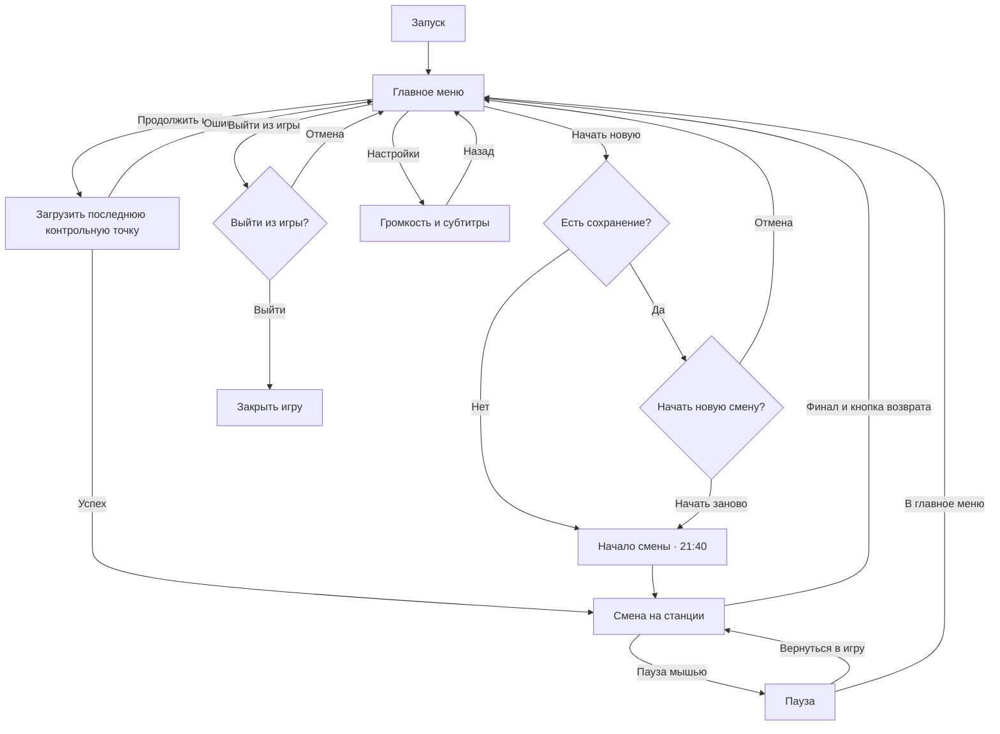

# Главное меню и путь игрока

Проект меню для UE 5.0.3. Прохор собирает макет, Слава подключает переходы и сохранение. Утверждаем поведение на сером макете.

## Экран

Слева тёмная панель примерно на 40% ширины. Сверху название DEAD AIR / «Мёртвый эфир», ниже четыре кнопки в таком порядке:

1. Продолжить игру
2. Начать новую
3. Настройки
4. Выйти из игры

Справа примерно 60% ширины. Пока там нейтральный тёмный фон с мягким переходом к левой панели. Позже сюда встанет широкая иллюстрация станции, гор и тарелки с лёгким размытием и туманом. Название и кнопки остаются резкими. Для кнопок подготовить обычное состояние, наведение, нажатие и недоступное состояние. Курсор виден сразу при запуске.

## Переходы

| Действие | Поведение в демо |
|---|---|
| Продолжить игру | Доступно при читаемом сохранении незавершённой смены. Без него кнопка приглушена, под ней «Нет сохранённой смены». При ошибке загрузки меню показывает «Не удалось загрузить сохранение» и оставляет доступными остальные действия. |
| Начать новую | Без сохранения открывает станцию в 21:40. Если есть незавершённая смена, показать «Начать заново? Текущая смена будет заменена». Кнопки «Начать заново» и «Отмена». Подменить слот после успешного входа в станцию и записи начальной точки. |
| Настройки | Общая громкость и субтитры, включённые по умолчанию. Изменения применяются сразу, сохраняются отдельно от смены. «Назад» возвращает в главное меню. |
| Выйти из игры | Короткое подтверждение с кнопками «Выйти» и «Отмена». |
| Пауза | Видимая кнопка мышью открывает «Вернуться в игру» и «В главное меню». Перед выходом из смены показываем, что сохранилась последняя контрольная точка. |
| Финал | «В главное меню» возвращает на начальный экран. Завершённая смена закрывает «Продолжить игру». |

Один слот автосохранения. Первая точка записывается при начале смены, следующие — в `docs/UE5_ARCHITECTURE.md`. При отмене новой игры текущая смена сохраняется. Повторные клики во время загрузки не запускают второй переход. Внутри окна подтверждения подложка не принимает клики.

## Первое задание команде

1. **Прохор** рисует левую панель и четыре кнопки. Показывает два состояния меню: до первого запуска игры и после записи контрольной точки. Справа оставляет серый фон. Отдельно рисует настройки и подтверждение новой игры.
2. **Слава** собирает главное меню в одном UMG-виджете. Подключает курсор и переход на карту станции. Затем связывает «Продолжить» с существованием и чтением SaveGame. Настройки хранятся отдельно от смены.
3. **Doki** принимает маршрут в Windows-сборке мышью. Начать смену, выйти в меню, продолжить, отменить новую игру, проверить громкость и субтитры после перезапуска, затем выйти через меню.

Меню готово к подключению арта, когда все четыре действия и возвраты проходят мышью, а фон можно заменить независимо от кнопок.
