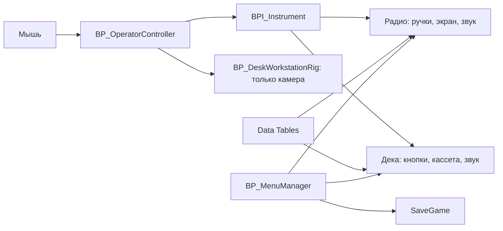

# DEAD AIR — устройство проекта UE 5.0.3

Актуальное состояние на 20.11.2026. Runtime: **Blueprints, UMG, Audio Components, материалы и Data Tables**. Редакторский RadioBuilder/Python в игре не требуются. Версию движка не менять; UE 5.4 не устанавливалась.

## 1. Запуск и ответственность систем

Открыть `nto_dead_air/nto_dead_air.uproject` в **5.0.3** после `git pull` и `git lfs pull`. Стартовая карта `/Game/UI/MainMenuMap`; игровая `/Game/StationIntegration/StationIntegrationMap`. RoomIntegrationMap — копия для просмотра. GlobalDefaultGameMode и карты используют `/Game/Interaction/BP_StationGameMode`, PlayerController — `BP_OperatorController`, DefaultPawn отсутствует. Шаблонный ThirdPerson больше не является зависимостью.

| Blueprint / данные | Ответственность |
|---|---|
| Interaction/BP_OperatorController | ЛКМ/ПКМ, трасса взгляда, HoveredInstrument/ActiveInstrument, блокировки, курсор, подсказка |
| Interaction/BPI_Instrument | Общий контракт для взаимодействия с прибором |
| StationIntegration/BP_DeskWorkstationRig | Обзор, ограниченный поворот, плавный переход к переданной камере/обратно |
| StationIntegration/BP_RadioIntegrated, родитель RadioExample/BP_RadioExample | Состояние приёмника, настройка, местные ручки/кнопка, звук, экран |
| StationIntegration/BP_TapeDeckIntegrated | Кассета, транспорт, кнопки, позиция аудио, вставка/снятие |
| StationIntegration/BP_CassetteIntegrated | Одна видимая модель, привязка к деке, визуальные фазы катушек |
| UI/BP_MenuManager, WBP_StationMenu | Страницы/переходы меню, запросы сохранения/загрузки, настройки/субтитры |
| UI/BP_MenuGameInstance | Переход между картами, пространство сохранений |
| UI/SG_StationCheckpoint, SG_UserPreferences | Учебный сеанс и отдельные настройки |
| DT_ReceiverProfiles, DT_ReceiverCaptions, DT_Tapes | Параметры станций/подписи/кассеты; новые записи существующего типа добавлять данными |

3D-стол — самостоятельная геометрия комнаты. Смена его текстуры/меша не меняет логику. Название BP_DeskWorkstationRig сохранено для узнаваемости, но он больше не знает конкретные приборы, HUD или их кнопки. Родитель радио не устанавливает view target, режим ввода или курсор.

## 2. Контракт и путь клика

BPI_Instrument содержит три функции:

| Функция | Вход / выход | Кто реализует |
|---|---|---|
| GetInstrumentView | Возвращает Actor камеры прибора | Радио и дека: ChildActor InteractionView |
| SetInstrumentState | Enabled, Overview → подтверждение | Прибор включает свои кнопки; радио также переключает FocusProxy |
| SetInstrumentHover | Hovered → подтверждение | Прибор меняет InstrumentHover на материале корпуса |

InitializeInteraction на контроллере находит камеру рабочего места и акторы с интерфейсом, создаёт WBP_InstrumentHint. Контроллер не хранит типизированных ссылок на радио/деку. Трасса из настоящего ракурса камеры определяет прибор; попадание в присоединённую кассету разрешается до её родительской деки. При смене цели подсветка старого прибора снимается.

FocusInstrument проверяет валидность/интерфейс/наличие камеры, состояние меню и перехода. ЛКМ использует текущую цель взгляда. Программный запрос может переключить стабильный прибор, но повтор того же запроса и запрос во время blend отклоняются. Камера получает только Target; кнопки включаются после завершения перехода. ПКМ очищает ActiveInstrument и возвращает к столу. Пустой/уничтоженный объект не меняет состояние.

ApplyInstrumentStates вызывается при изменении режима/паузы/перехода, а не сбрасывает DragMode каждый кадр. Меню имеет приоритет; после закрытия разрешён только активный прибор. Курсор скрыт в обзоре, виден в меню/приближении; его случайный повторный показ менеджером меню исправляется контроллером. RecenterFocusedCursor проверяет размер viewport перед SetMouseLocation.

У камер приборов локальные трансформации относительно самих приборов: перемещение целого actor переносит кнопки, звук и ракурс вместе. ViewCenter остаётся у rig: local (94;117;112), высота 137,31 см, pitch −10,5°, yaw −108°, FOV 85. Обзор ±48°/±14°; край экрана 5%, задержка 0,35 с, плавный переход к кровати с сектором ±16°. Возврат к столу сбрасывает RoomTurn. Камера у прибора неподвижна.

Славе: сначала открыть EventGraph/InitializeInteraction/WatchCameraState/FocusInstrument контроллера, затем три функции BPI у радио/деки и FocusCamera/FocusCenter rig. Физическое нажатие и круговая математика ручки остаются внутри прибора; общая навигация туда не переносится. Старый WBP_WorkstationControls, скрытые кнопки и промежуточные пробросы команд удалены.

## 3. Радио, дека и звук

Радио хранит дробную частоту в кГц, отображаемое значение, громкость, питание, фильтр и текущий профиль. ЛКМ с круговым движением мыши вращает ручку 1:1. Фильтр доступен при OFF/поиске; оптимум и ширина станции берутся из данных. Шум плавно зависит от расстройки, меняет полосу/тембр; речь и шумовые слои разделены. При уходе с канала эфир продолжает идти. Верхний дисплей сочетает осциллограмму и спектрограмму, два нижних окна показывают числа/статус; OFF закрывает три окна чёрным и гасит их свет. Ручную раскладку WBP_RadioDisplay/RadioScreen не перезаписывать.

Дека использует одну свободную кассету из комнаты. CassetteShell — видимый корпус, ReelA/B — необходимые невидимые драйверы фаз материала M_CassetteAssetAnimated; это не вторая модель. Корпус неподвижен, PLAY вращает ступицы, FF/REW ×3 меняют скорость/направление, STOP замораживает именно MID. Кнопки остаются внизу до новой команды/конца ленты. Вставка/извлечение — дуга 0,85 с с защитой повторов. ЛКМ по кассете запускает перенос только у активной деки.

Радио и дека — независимые пространственные Audio Components. При одновременной речи ReadSubtitle показывает оба слышимых источника; интервалы DT_ReceiverCaptions привязаны к реальной позиции записи. Временная озвучка не заменяет AUDIO_SCENARIO. REW использует подготовленный reverse PCM и положительный pitch ×3; разрешён максимум ×3 в конфиге. Нулевой/поздний OnAudioPlaybackPercent не может сбросить восстановленный seek: сохранены SeekingAudio и проверка допустимого направления позиции.

Новый сигнал существующего типа добавлять в DT_ReceiverProfiles и соответствующие строки DT_ReceiverCaptions, новую кассету — в DT_Tapes, по реальным Blueprint-структурам рядом с таблицами. Проверять пустую строку, неверную длительность, границы частоты и отсутствие клипа; не добавлять новую ветку графа на каждую запись.

## 4. Меню и сохранение

WBP_StationMenu — 1920×1080 внутри ScaleBox; данные и файлы обслуживает BP_MenuManager. Страницы: главное меню, пауза, три слота, настройки, подтверждения. Пустые/повреждённые слоты недоступны, отмена не стирает существующие данные. Слоты тёмные с читаемым светлым текстом, без декоративных точек; точки в дате допустимы. IBM Plex Mono Medium/SemiBold и OFL включены в проект.

| Действие | Результат |
|---|---|
| Новая игра | Подтверждение замены при наличии autosave → общий стол → новая начальная точка |
| Продолжить / загрузить | Проверка структуры/параметров → восстановление сеанса → обзор стола |
| Ручное сохранение | Запись выбранного слота и autosave; ручные слоты не стираются новой игрой |
| Возврат в главное меню | Сохранить сеанс, скрыть субтитры, guarded fade-out, сменить карту |
| Настройки | Отдельные громкость и субтитры, переживают смену карты |

Вход проявляет стол из чёрного за две секунды; меню-видео не декодируется во время игры. Каждый возврат открывает видео заново с нормальной скоростью, без догоняющей перемотки. Субтитры скрыты во всех страницах меню.

Файлы: Saved/SaveGames/DA_UI_Auto, DA_UI_Manual_1..3, DA_UI_Prefs. В сборке — Saved приложения. Тесты используют уникальные DA_*_QA_ и отдельный UserDir, пользовательские слоты не трогают. Проверяются Version, диапазоны, HasWorkstation/HasTransportState и согласованность транспорта. Старый radio-only checkpoint открывает пустую деку. В движении кассеты сохраняется последнее устойчивое состояние, загрузка отменяет анимацию; PLAY/FF/REW и зафиксированная клавиша восстанавливаются.

Сейчас это учебный сеанс, не вся история. Славе добавить фазу/часы, предметы, архив/таймер, найденные кассеты, смысловые сегменты T2, заметки, одноразовые события, принятие прямого запроса и один исход 50/50. После загрузки сначала восстановить системы, затем UI; не повторять выдачу предметов/писем и голос уже пройденной сцены. После финала закрывать «Продолжить».

Вход в паузу через кровать ещё не подключён. Старой верхней кнопки МЕНЮ и быстрых переходов нет; не возвращать их как обход проблемы. Подключить существующий OpenPause к принятому взаимодействию с кроватью, не меняя два сюжетных отдыха.

## 5. Комната, материалы и художник

Комната восстановлена без установки UE 5.4: совместимые пакеты использованы с зависимостями, новые MeshDescription/FCompressedBuffer извлечены инструментом RoomBridge, текстуры/материалы пересозданы в 5.0.3. Не менять версию заголовка uasset для «конвертации».

Внутренний PNG UE TSF_BGRA8/TSCF_PNG хранит BGRA под PNG-разметкой. prepare_room_assets.py нормализует R/B только для этого сочетания. Исправлены 42 изображения; два grayscale PNG и два JPEG не менялись. import_room_assets.py сохраняет decoded_sha256 и DeadAir.SourceDecode. Не компенсировать ошибочное декодирование ручной окраской или normal map поверх него. У коробок исходные UV, albedo/normal/ORM, metallic=0.

Корпус деки 37,04×24,69×8,49 см, scale0,6710495, yaw−86°, центр (414;402;94). Кассета сохраняет отдельный физический размер; tray/socket и дуга относятся к деке. Радио целым actor перемещено к центру корпуса (498;404;107), масштаб/ручные экраны сохранены. Системный блок удалён только из сцен, его source mesh сохранён. Компьютерное крыло столешницы расширено по 8 вершинам до 100,16 × 118,75 см: world X 454,99..555,15, Y 255..373,75, верх Z 89,656. Ножки, задняя часть, pivot, UV и slots сохранены; complex collision пересобрана. Монитор/клавиатура/мышь/блокнот/наушники стоят на поверхности с техническим зазором 0,02 см. CassetteSocket relative Z 13,528974, CassetteTray Z 2,921684: низ кассеты 96,908 см, пол отсека 96,883, верх кассеты 98,113 ниже стекла 98,225. У Detail_Стекло нет коллизии/тени, M_DeckGlass opacity0,10; кассета кликается сквозь крышку. Свободная кассета также выставлена на tray в редакторе. Настольная лампа: 2900 K, 0,08 cd, радиус 100 см; центральная 3300 K, 1,25 cd, с тёплым видимым материалом. У каркаса светильника M_RoomLampHousing (тёмный металл) вместо технического WorldGridMaterial. Насыщенность комнаты 0,52 сохранена. Окна M_RoomClearGlass opacity0,025; внешний ночной задник технический.

Тарелка — Тарелка(NEW)4, исходник SourceArt/DishLatest.fbx. У рабочей копии удалено 1560 точных совпадений после триангуляции, осталось 3688 треугольников; transform исходной комнаты сохранён. Двухсторонний металлический материал не исправляет исходную топологию: 7 обратных оболочек, одна открытая с 32 граничными рёбрами. [Проверка тарелки](../artifacts/dish-latest-report.json).

Клавиатура — [tevy Mechanical Keyboard](https://tevy.dev/models/mechanical-keyboard), CC0,8814 треугольников,36 см, кабель убран. Исходный GLB/License/TSV/PNG находятся в SourceArt/KeyboardTevy; winding переведён в clockwise UE, normal G переворачивается из OpenGL при импорте. Клавиатура декоративная, новых кнопок управления нет.

Папка **DEAD_AIR_3D_ARTIST** на рабочем столе содержит FBX текущих моделей с UV/pivots/material slots,72 PNG, Models.csv/manifest.json, инструкцию художнику и Reference_Room.fbx. 48 игровых моделей/деталей +2 справочных примитива UE. Source ссылки и параметры normal/sRGB записаны в manifest; новые текстуры отдавать отдельной папкой. Не менять pivots/UV/слоты кнопок и катушек без интеграционной правки. Стороннее авторство сохраняется, лицензии комнаты ещё дополняются по SUBMISSION_CHECKLIST.

## 6. Редакторские инструменты и очистка

Tools/RadioBuilder — редакторский плагин, не подключён к .uproject. BlueprintAuthoring.inl содержит общие помощники графов; InteractionRefactor.inl — текущую миграцию/сборку взаимодействия, ModelPreparation.inl — восстановление подготовленных mesh. RoomBridge оставлен для проверенного восстановления исходных payload; старые генераторы прототипа/промежуточных камер удалены.

Текущий порядок: импорт конкретных новых исходников через import_desk_assets.py → при необходимости -PrepareModels; для взаимодействия -InteractionRefactor → install_interaction.py; расстановка/свет — style_workstation.py (после актуального -FurnitureGeometryAudit; расширение столешницы -FurnitureWidenTop защищено от повторного применения); проверка — verify_room_assets.py. Рабочие uasset/umap уже сохранены: Славе не нужно запускать генератор для игры. Сначала работать в Blueprint Editor и сохранять один бинарный ассет одним владельцем.

Аудит: audit_project.py собирает hard/soft/manage/searchable ссылки, все модели/экземпляры; ProjectAudit выводит структуру графов. Перед удалением — явные корни главной/игровой/обзорной карт, GameInstance и GameMode, отсутствие входящих ссылок из сохраняемого набора. Непрямые OpenLevel строки покрыты корнями. Не считать папку RadioExample «зомби»: там живой родитель/данные/материал радио. Кэши/Saved исключены из Git; физические пользовательские сохранения и настройки оставлены. История Git не переписывается.

Экспорт художнику: export_artist_models.py использует стандартный FBX и source textures. В 5.0 нет PNG-экспортёра Texture2D: извлечение TGA/BMP затем lossless PNG на хосте с проверкой пикселей. Папка с уже завершённым manifest защищена от случайной перезаписи. При новом экспорте не перетирать работу художника. Обновлённый стол и справочная комната экспортируются отдельно с -ArtistFurnitureUpdate в DEAD_AIR_3D_ARTIST/Updates/DeskFit; старые Models/Textures не заменяются.

## 7. Проверки и следующая интеграция

Проверять реальный runtime, не только наличие файлов. InteractionVerify проверяет владение кодом, интерфейсы, реальные ЛКМ/ПКМ, невалидный/уничтоженный объект, повтор, blend, меню и ворота кнопок. TransportVerify — радио/деку,×3, независимый звук, курсор, fade, OFF, меню. CassetteMotionVerify — полный контур, перенос, повтор, сохранение/загрузку и катушки. ReceiverVerify -PowerHitboxOnly — лучи через видимую кнопку и соседние органы управления. RoomPolishVerify — комнату, мышиный обзор кровати и видимый MID катушек. MenuVerify — слоты, повреждённые данные, переходы и восстановление сеанса. FurnitureSeatAudit — физическая опора пяти предметов по 9 точкам, новая коллизия столешницы, посадка/кликабельность/извлечение кассеты и тёплый свет; сохраняет реальные кадры в Saved/FurnitureFit.

Для CompileAllBlueprints в 5.0.3 используется **AllowListFile со всеми текущими project Blueprint/UMG**: ProjectOnly этим commandlet не поддерживается, без списка компилируются ещё и учебные ассеты самого движка. Скорость FF/REW проверяется по реальной позиции аудио; пороги×3 не ослабляются из-за запуска теста. Проверка центрирования вызывает production handler непосредственно в PIE; это не ручное отслеживание системного курсора с внешними окнами.

Windows Development собирается установленной 5.0.3/MSVC14.38.33130; после cook отдельно запускать MainMenuMap и StationIntegrationMap из готового exe с изолированным UserDir. Только после успеха публиковать нормальным push в dev. Финальный протокол этой правки фиксируется в PROJECT_CONTEXT и отчёте аудита; полное сюжетное прохождение/другой ПК остаются отдельной приёмкой.

Дальше: первая квитанция из данных → REC/таймер/архив → два отдыха и кассеты → SOS/резерв/поиск → сохранение решений/финалы, строго по SCENARIO/MECHANICS/AUDIO_SCENARIO. Story слушает результаты приборов, но не хранится в виджете или модели стола; не строить универсальную систему квестов ради трёх задач.

Последний протокол 20.11: 15 Blueprint/UMG с 0 ошибками/предупреждениями; 197/0 PIE (Interaction 25, Room 18, Receiver 32, Transport 55, Cassette 29, Menu 38), 60/0 ассетов; Windows Development cook успешен, обе карты из exe по 12 с / exit 0. Состав pak проверен на отсутствие удалённых шаблонов. Подробности/границы — [аудит](../artifacts/project-audit-report.json); [общий обзор](../artifacts/room-overview.png), [радио](../artifacts/room-radio.png), [дека](../artifacts/room-deck.png). Новые графы получили компактное размещение узлов и пояснения ключевых функций; UMG/ручные трансформации экрана не изменялись.
